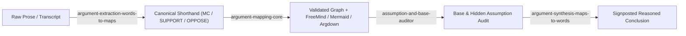

# Digital Thinking Tools — AI Skills Suite

A suite of **13 AI Agent Skills** adapted from The Open University's OpenLearn course [*Digital thinking tools for better decision making* (DTT_1)](https://www.open.edu/openlearn/science-maths-technology/digital-thinking-tools-better-decision-making/content-section-overview).

Every skill is authored in **ASD-STE100 Simplified Technical English** in an STE-style controlled language (a linted subset of ASD-STE100) to reduce grammatical ambiguity, backed by **zero-dependency Python 3 CLI tools** and automated unit tests.

## Architecture Highlights

- **Course Coverage (Sessions 1–8)**: Each session maps to at least one skill (see catalog). A per-section coverage matrix is not published yet.
- **STE-style Controlled Language**: All 13 `SKILL.md` files are linted in strict mode (`<= 20` words per procedural sentence, `<= 25` words descriptive, active voice, imperative mood, zero semicolons, zero em/en-dashes).
- **Comprehensive Argument Mapping Suite (4 Skills)**: End-to-end argument dissection (`Words -> Maps`), synthesis (`Maps -> Words`), base-evidence & implicit-assumption auditing, and multi-format export (**FreeMind `.mm`**, **Mermaid**, **Argdown**, **JSON**).
- **Zero External Dependencies**: All executable scripts use Python 3.10+ standard library only.

## Skill Catalog

| Skill (`skills/<name>`) | Course Session | Core Capability | Executable Script |
| :--- | :--- | :--- | :--- |
| `argument-mapping-core` | Sessions 4, 6, 7 | Build, validate, audit, and export Level 0–N argument maps | `scripts/argmap_tool.py` |
| `argument-extraction-words-to-maps` | Sessions 6, 7 | 3-step Words-to-Maps recipe, connector table, Dialogue Test | — |
| `argument-synthesis-maps-to-words` | Session 4 | 5-step Maps-to-Words recipe with signposting & scope limits | — |
| `assumption-and-base-auditor` | Sessions 4, 7 | Tipped-over pyramid base audit & Tor Stinks assumption flip | — |
| `critical-pros-cons-matrix` | Session 1 | Impartial Pros/Cons tables & 5 Digital Levers scoring | — |
| `infographic-perspective-auditor` | Session 1 | McCandless relative metrics, knowledge compression, bias audit | — |
| `precision-search-operator-builder` | Session 2 | Google operators, filter-bubble bursting, Wikipedia forensics | — |
| `source-triangulation-and-prompt` | Session 2 | 6-part PROMPT checklist & Creeping Fox Terrier Clone check | — |
| `fermi-estimation-calculator` | Session 3 | Fermi decomposition, `round(x, -k)`, Availability Heuristic check | `scripts/fermi_calc.py` |
| `euler-set-reasoning` | Session 5 | Euler vs Venn diagrams, Lewis Carroll syllogisms, Conjunction check | `scripts/euler_sets.py` |
| `bayesian-base-rate-and-sample-auditor` | Session 5 | False Positive Paradox & Law of Small Numbers simulation | `scripts/base_rate_calc.py` |
| `ai-epistemic-and-logic-auditor` | Session 8 | Rationalist/Empiricist limits, bias/opacity, Arendt principle | — |
| `asd-ste100-skill-linter` | Cross-cutting | Enforces ASD-STE100 rules on AI skills and prompts | `scripts/ste100_linter.py` |

## Argument Mapping Workflow



## Quickstart

### 1. Clone & Verify

```bash
git clone https://github.com/bio-colab/DTT-AI.git
cd DTT-AI

# Run ASD-STE100 Linter across all 13 skills
python3 skills/asd-ste100-skill-linter/scripts/ste100_linter.py skills/

# Run full unit & integration test suite
python3 -m unittest discover -s tests -v
```

### 2. Use the CLI Tools Directly

```bash
# Audit & export an Argument Map to Mermaid
python3 skills/argument-mapping-core/scripts/argmap_tool.py \
  --input "MC 'Eating carrots improves eyesight.' SUPPORT 1 'Carrots contain Vitamin A.'" \
  --format mermaid

# Solve the False Positive Paradox (0.1% base rate, 99% test accuracy)
python3 skills/bayesian-base-rate-and-sample-auditor/scripts/base_rate_calc.py \
  false-positive --base-rate 0.001 --accuracy 0.99 --population 100000
```

### 3. Install into AI Agents

Copy any folder from `skills/<skill-name>/` into your agent's skills directory (e.g., `.claude/skills/`, `.gemini/skills/`, or your MCP/Codex skill registry).

## Attribution & License

- **Skills text and docs** (`skills/**/SKILL.md`, `docs/`): adaptations of the course below, so they are distributed under CC BY-NC-SA 4.0 (non-commercial, share-alike).
- **Course Content**: Adapted from *Digital thinking tools for better decision making* (DTT_1), © 2019–2020 The Open University, released under [CC BY-NC-SA 4.0](https://creativecommons.org/licenses/by-nc-sa/4.0/).
- **Code & Tooling**: Original Python scripts, tests, and repository scaffolding are licensed under the MIT License (see `LICENSE`).

## Status & Limitations

- **No empirical evaluation yet.** There is no measured evidence that these skills improve answer quality or reduce hallucination. A with/without-skill comparison is planned work.
- **The linter is partial.** It checks sentence length, punctuation, passive-voice heuristics, and a small banned-word list. It does not check the official STE dictionary.
- **Tests check structure and script output**, not agent behaviour.
- English only.
